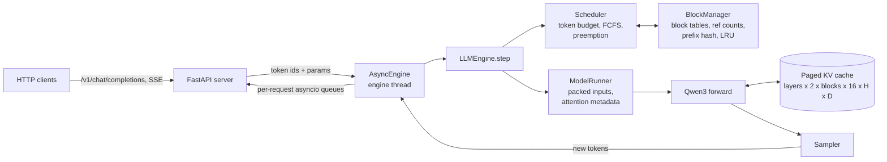

# nanoserve

A small LLM inference engine in the style of vLLM, written from scratch in PyTorch (about 1,600 lines). It serves
[Qwen3](https://huggingface.co/Qwen/Qwen3-0.6B) models through an OpenAI-compatible API and implements the core ideas of
a modern serving engine:

- **Paged KV cache.** K/V live in fixed-size blocks. Each request holds a block table, so memory is allocated per block
  as a sequence grows instead of reserving `max_model_len` up front.
- **Continuous batching.** The scheduler rebuilds the batch every step: finished requests leave and new ones join
  without waiting for the rest of the batch.
- **Chunked prefill.** Each step has a token budget. Long prompts are split across steps and share them with running
  decodes, so a 2k-token prompt doesn't stall everyone else's next token.
- **Prefix caching.** Full blocks are content-addressed by a chained hash (parent hash + tokens). Requests that share a
  prefix (system prompt, few-shot examples, multi-turn chat) reuse the cached blocks and skip that prefill. Freed blocks
  stay cached in an LRU pool until the memory is needed.
- **Preemption by recompute.** When the cache is full, the newest running request gives up its blocks and is requeued
  at the front. Its prefix is often still cached when it comes back.
- **Triton paged-attention decode kernel.** On CUDA, every decode reads K/V straight from the block table with an online
  softmax instead of gathering them into a padded buffer, including in steps that also carry prefill chunks. 14 to 19x
  faster than the gather path at batch 16 to 64 on an L4.
- **Packed batches.** All new tokens in a step are packed into one `[T]` dimension; only attention needs per-sequence
  structure. QKV and gate/up projections are fused into one matmul each.
- **Sampling.** Temperature, top-k, top-p with one shared sort, and per-request seeds that give the same tokens no matter
  what else is in the batch.
- **OpenAI-compatible server.** `/v1/completions` and `/v1/chat/completions` with SSE streaming, prompt-cache usage in
  the response (`prompt_tokens_details.cached_tokens`), client-disconnect aborts, and Prometheus `/metrics`.

Correctness is tested against Hugging Face `transformers`: greedy decoding produces exactly the same tokens as HF for
every request, under continuous batching, chunked prefill, prefix-cache hits and preemption.

## Architecture



One engine step:

1. **Schedule.** Running requests first (1 token per decode, the next chunk for a request still in prefill), then
   waiting requests while the token budget and free blocks allow. On admission, the block manager matches the longest
   cached prefix and marks those tokens as already computed.
2. **Prepare.** Flatten every request's new tokens into `input_ids[T]` and `positions[T]`, compute each token's cache slot
   from its block table, and build the attention metadata once for all layers.
3. **Forward.** Each layer writes this step's K/V into the paged cache, then attends over the full context through the
   block table. Logits are computed only for requests whose prompt is fully processed.
4. **Sample and update.** Append tokens, publish newly full blocks to the prefix cache, finish requests on EOS or
   `max_tokens`, and free their blocks.

| File | What it does |
|---|---|
| [`block_manager.py`](src/nanoserve/block_manager.py) | Block allocation, ref counts, chained-hash prefix cache, LRU eviction |
| [`scheduler.py`](src/nanoserve/scheduler.py) | Continuous batching with a token budget, chunked prefill, preemption |
| [`model_runner.py`](src/nanoserve/model_runner.py) | Weight loading, KV cache sizing, packing a batch into one forward pass |
| [`attention.py`](src/nanoserve/attention.py) | Paged attention (torch gather + SDPA path for any mix of prefill and decode) |
| [`triton_attention.py`](src/nanoserve/triton_attention.py) | Triton paged decode kernel with online softmax and GQA |
| [`models/qwen3.py`](src/nanoserve/models/qwen3.py) | Qwen3 decoder for packed, paged inference (fused QKV and gate/up) |
| [`sampler.py`](src/nanoserve/sampler.py) | Batched temperature, top-k, top-p and seeded sampling |
| [`engine.py`](src/nanoserve/engine.py), [`async_engine.py`](src/nanoserve/async_engine.py) | Step loop, stop conditions, background engine thread |
| [`server.py`](src/nanoserve/server.py) | OpenAI-compatible API, streaming, Prometheus metrics |

## Quick start

```bash
git clone https://github.com/cipheraxat/nanoserve && cd nanoserve
uv sync
uv run nanoserve --model Qwen/Qwen3-0.6B --port 8000
```

```bash
curl -s localhost:8000/v1/chat/completions -H 'content-type: application/json' \
  -d '{"messages":[{"role":"user","content":"What is 17*23?"}],"max_tokens":32,"temperature":0}'
```

Offline use:

```python
from nanoserve import EngineConfig, LLMEngine, SamplingParams

engine = LLMEngine(EngineConfig(model="Qwen/Qwen3-0.6B", max_num_batched_tokens=512))
outputs = engine.generate(["The capital of France is"], SamplingParams(max_tokens=16, temperature=0))
print(engine.tokenizer.decode(outputs[0]))
```

Useful flags: `--max-num-seqs`, `--max-num-batched-tokens` (the chunked-prefill budget), `--kv-cache-memory-gb`,
`--block-size`, `--no-prefix-caching`, `--attention-backend {auto,torch,triton}`.

## Benchmarks

All runs use Qwen3-0.6B in bf16 with greedy decoding and `ignore_eos`, so every request generates exactly the tokens
it asked for.

### NVIDIA L4 (Colab, torch 2.11 + CUDA 13, Triton 3.6)

**Continuous batching vs static batching.** 128 requests with 32 to 512 prompt tokens and 16 to 256 output tokens,
at most 64 in flight:

| system | time | output tok/s |
|---|---|---|
| nanoserve (continuous batching, paged KV, Triton decode) | 20.5 s | 915 |
| Hugging Face `generate`, static batches of 64 | 80.7 s | 233 |

3.9x the throughput. Static batching pads every batch to its longest prompt and keeps decoding until its longest
request is done; continuous batching refills the slot as soon as a request finishes.

**Triton paged decode kernel vs torch gather + SDPA**, one attention layer at Qwen3-0.6B's shape (16 query heads,
8 KV heads, head dim 128), bf16:

| batch | context | torch gather | Triton paged | speedup |
|---|---|---|---|---|
| 1 | 2,048 | 0.46 ms | 0.18 ms | 2.5x |
| 16 | 2,048 | 10.86 ms | 0.62 ms | 17.4x |
| 64 | 512 | 10.65 ms | 0.58 ms | 18.5x |
| 64 | 2,048 | 43.76 ms | 2.66 ms | 16.4x |
| 64 | 8,192 | 171.71 ms | 12.50 ms | 13.7x |

Max absolute difference from the reference is within bf16 rounding (at most 5e-4).

The kernel only paid off once it handled every decode. Under continuous batching most steps carry a prefill chunk
next to the running decodes, and at first those mixed steps sent every sequence down the gather path. With that
design nanoserve reached only 168 tok/s on the benchmark above, slower than Hugging Face. The engine now splits each
step: decodes go through the kernel, prefill chunks through the gather path, and the results are scattered back into
the packed batch. That took throughput from 168 to 915 tok/s.

**Prefix caching.** 32 requests share a 1,024-token system prompt, each with a different 32-token suffix and 32 output
tokens:

| prefix caching | total time | prompt tokens computed | cache hit rate | TTFT p50 | TTFT p99 |
|---|---|---|---|---|---|
| off | 11.1 s | 34,784 | 0% | 5.22 s | 10.00 s |
| on | 4.9 s | 3,040 | 94% | 2.03 s | 3.82 s |

11x less prefill work, 2.3x faster end to end, 2.6x lower median TTFT.

**Chunked prefill.** 16 requests are decoding while six 2,048-token prompts arrive. Inter-token latency (ITL) seen by the
decoding requests:

| token budget per step | ITL p50 | ITL p99 | ITL max |
|---|---|---|---|
| unlimited (whole prompt in one step) | 35 ms | 473 ms | 474 ms |
| 512 | 35 ms | 130 ms | 130 ms |
| 256 | 35 ms | 65 ms | 65 ms |

A 256-token budget cuts the worst decode stall 7.3x with no change to median ITL.

### Apple M4, 16 GB (MPS)

These were taken before the decode/prefill split, which only matters on CUDA.


**Prefix caching.** 32 requests share a 1,024-token system prompt, each with a different 32-token suffix and 32 output
tokens:

| prefix caching | total time | prompt tokens computed | cache hit rate | TTFT p50 | TTFT p99 |
|---|---|---|---|---|---|
| off | 100.4 s | 34,784 | 0% | 47.1 s | 96.9 s |
| on | 15.1 s | 3,040 | 94% | 7.1 s | 12.2 s |

6.6x faster end to end, with 11x less prefill work.

**Chunked prefill.** 16 requests are decoding while six 2,048-token prompts arrive. Inter-token latency (ITL) seen by the
decoding requests:

| token budget per step | ITL p50 | ITL p99 | ITL max |
|---|---|---|---|
| unlimited (whole prompt in one step) | 81 ms | 21.5 s | 23.5 s |
| 512 | 71 ms | 4.5 s | 4.6 s |
| 256 | 74 ms | 2.2 s | 2.3 s |

A 256-token budget cuts the worst decode stall about 10x, at no cost to median ITL.

**Continuous batching vs static batching.** 64 requests with 32 to 512 prompt tokens and 16 to 256 output tokens, at
most 32 in flight: nanoserve 60.0 output tok/s vs Hugging Face `generate` with static batches of 32 at 50.3 tok/s (1.19x).

On this machine MPS is limited by kernel launch overhead and memory pressure: a single 2,048-token prefill takes about
3 s in both nanoserve and Hugging Face. The absolute numbers are low; the comparisons are what these runs show.

Reproduce with the scripts in [`benchmarks/`](benchmarks/) (`bench_offline.py`, `bench_prefix.py`, `bench_chunked.py`,
`bench_attention.py`, and `bench_serving.py` for an online Poisson load test against a running server). Raw JSON is in
[`benchmarks/results/`](benchmarks/results/). The L4 numbers come from one Colab run that cloned this repo at the
split-attention commit, ran the test suite on the GPU, then ran the four benchmarks;
[`scripts/colab_gpu_bench.py`](scripts/colab_gpu_bench.py) does the same through the `colab` CLI.

## Tests

```bash
uv run pytest -q
```

The tests build a tiny random Qwen3 with Hugging Face `transformers`, load the same weights into nanoserve, and require
identical greedy tokens across batching, chunking, prefix caching and preemption. They also cover the block manager,
scheduler, sampler (top-k/top-p against a brute-force reference, distribution, seeds), the HTTP server (streaming,
validation, concurrency, metrics), the decode/prefill split (on CPU, with a torch stand-in for the kernel), and on CUDA
the Triton kernel against the torch path plus an end-to-end engine run. Everything except the CUDA tests runs on CPU
without downloading anything; all 40 pass on an L4.

## Notes and limits

- Only the Qwen3 dense architecture is implemented. Adding another decoder means a model file like
  [`models/qwen3.py`](src/nanoserve/models/qwen3.py).
- Single device; no tensor parallelism, CUDA graphs or quantization.
- On Apple Silicon (MPS), two slow paths showed up while profiling: advanced indexing for the K/V gather is about 6x
  slower than `index_select`, and a `[>8, 1024] x [1024, 151936]` LM-head matmul falls off the fast path (about 8x
  slower at 32 rows). The engine uses `index_select` everywhere and slices the vocabulary projection on MPS.

## License

MIT
